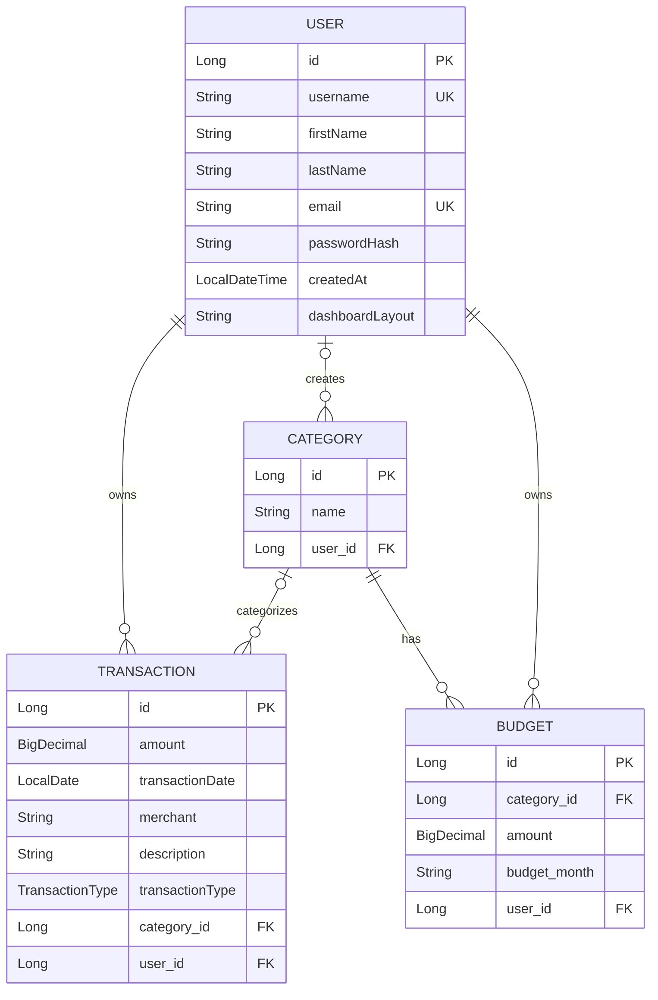

# FinSight – Data Model

This document describes the database structure of the FinSight application. The data model consists of four main entities: User, Transaction, Category and Budget.

## 1. User

The `users` table contains information about application users.

| Column | Data Type | Constraints |
|---|---|---|
| id | Long | PK, auto-generated |
| username | String | NOT NULL, UNIQUE, max 50 |
| firstName | String | NOT NULL, max 100 |
| lastName | String | NOT NULL, max 100 |
| email | String | NOT NULL, UNIQUE, max 100 |
| passwordHash | String | NOT NULL, max 255 |
| createdAt | LocalDateTime | NOT NULL |
| dashboardLayout | String | NULL allowed, max 10000 |

## 2. Transaction

The Transaction entity contains users' income, expense and transfer transactions.

| Column | Data Type | Constraints |
|---|---|---|
| id | Long | PK, auto-generated |
| amount | BigDecimal | NOT NULL, precision 12, scale 2 |
| transactionDate | LocalDate | NOT NULL |
| merchant | String | NOT NULL, max 150 |
| description | String | NULL allowed, max 500 |
| transactionType | TransactionType | NOT NULL, ENUM (STRING) |
| category_id | Long | FK, NULL allowed |
| user_id | Long | FK, NOT NULL |

## 3. Category

The Category entity contains categories used to classify transactions. A category can be user-specific or a shared default category available to all users.

| Column | Data Type | Constraints |
|---|---|---|
| id | Long | PK, auto-generated |
| name | String | NOT NULL, max 100 |
| user_id | Long | FK, NULL allowed |

## 4. Budget

The Budget entity contains monthly budget limits defined by users for different categories.

| Column | Data Type | Constraints |
|---|---|---|
| id | Long | PK, auto-generated |
| category_id | Long | FK, NOT NULL |
| amount | BigDecimal | NOT NULL, precision 12, scale 2 |
| budget_month | String | NOT NULL, max 7 |
| user_id | Long | FK, NOT NULL |

Budget uniqueness is enforced by a combination of `user_id`, `category_id` and `budget_month`. This means that a user cannot create multiple budgets for the same category in the same month.

## 5. Entity Relationship Diagram (ERD)

The following ER diagram illustrates the relationships between the entities in the database.

## 6. Relationships and Constraints

- A user can have multiple transactions, budgets and personal categories.
- Each transaction belongs to exactly one user and can optionally be assigned to one category.
- Categories can be personal or shared default categories. A shared default category is not associated with a specific user.
- Each budget belongs to exactly one user and one category.
- A user can have only one budget for the same category in a given month. This is enforced by a unique constraint on `user_id`, `category_id` and `budget_month`.
